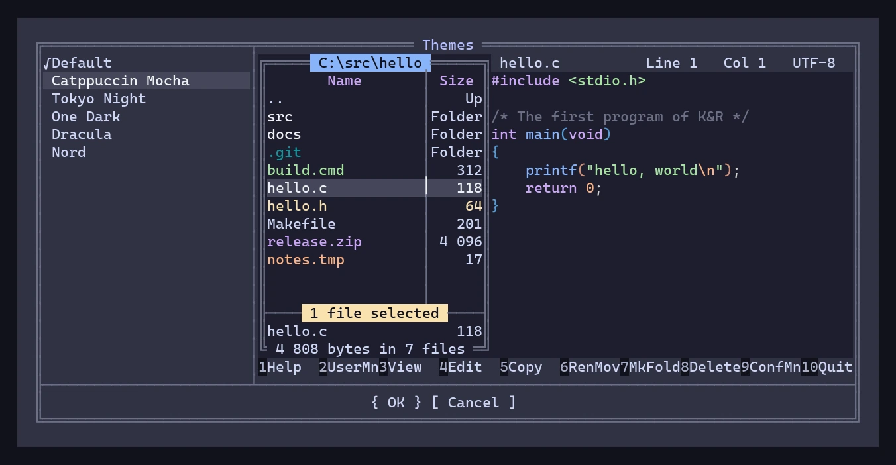
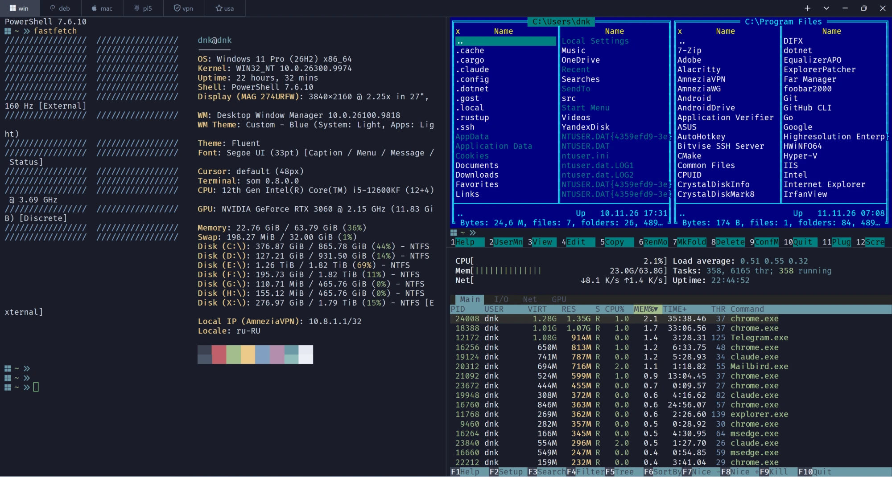
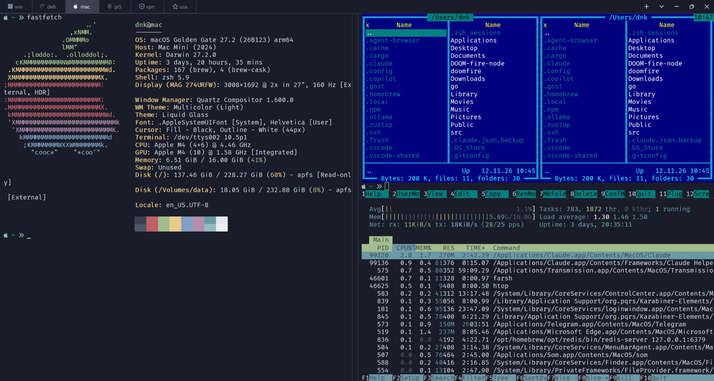
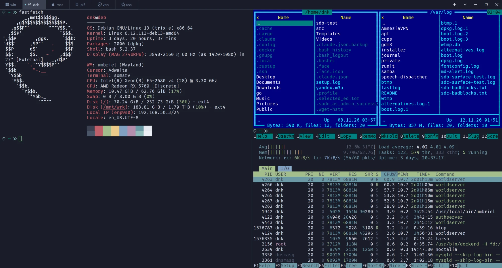
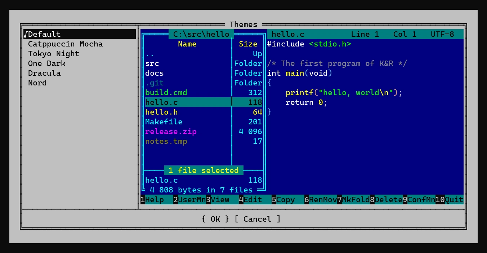
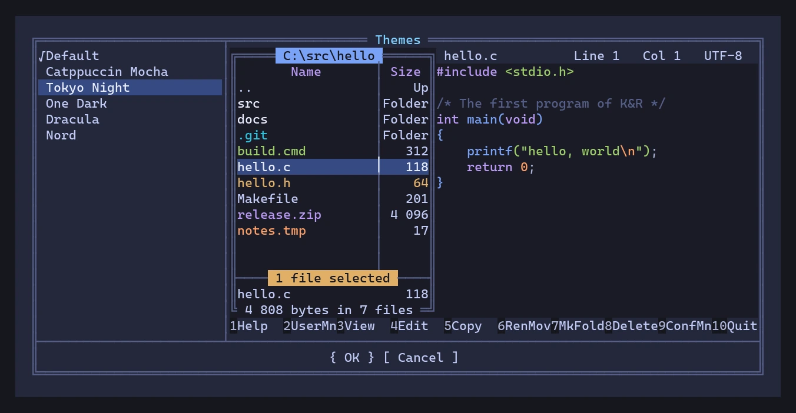
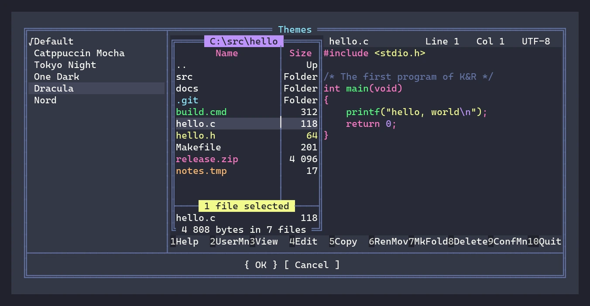

# farsh

**Far Manager, built into your real shell.** Not the other way round.



Far Manager has always had a command line. It was Far's own: a single edit
box that hands your command to `cmd.exe` and forgets it. No completion of your
shell, no aliases, no functions, no prompt, no history search, no PSReadLine,
no fzf. A file manager with a shell bolted on.

**farsh turns that upside down.** It starts your real shell — bash, zsh or
PowerShell — in a PTY, exactly as a terminal would, and puts Far's panels on
top of it. The line under the panels *is your shell's prompt line*: your
starship/oh-my-zsh/oh-my-posh prompt is there, what you type goes into the
shell's own line editor, your aliases, functions and history are the shell's.
Press `Ctrl+O` and the panels are gone: what is left is your shell, untouched —
every key is its own again (Tab completion, `Ctrl+R`, your bindings), with your
terminal's own scrollback, selection, mouse and hyperlinks. Press it again and
Far is back, re-read, cursor where you left it.

It is a shell you can make your login shell. It is a Far Manager that feels
like Far 3 down to the cell. It is a viewer that plays video in the terminal.
It is one binary, on Windows, Linux and macOS.

## On every system

The same farsh in PowerShell on Windows, zsh on macOS and bash on Debian — the panels top
right, htop under them, a plain shell with fastfetch on the left: farsh lives
next to your programs, not instead of them.







## Why it is different

- **The shell is the boss, Far is the guest.** farsh never parses or
  re-implements your command line. Everything you type goes to the shell's own
  line editor; farsh only reads the screen to know where the prompt is. Enter on
  a typed command runs it in the shell and the panels step aside for its
  output.
- **Without the panels, farsh is invisible.** The shell owns the terminal's
  main screen and its output goes to the terminal byte for byte — your
  terminal's history, reflow, selection, OSC 7/8 and mouse modes work as if
  farsh were not there. The panels live on the alternate screen; whatever the
  shell prints while they are up is held and delivered when they go.
- **A login shell that cannot lock you out.** On Linux/macOS put farsh in
  `/etc/shells` and `chsh -s` to it. `ssh host cmd`, scp, rsync, scripts,
  `-c`, pipes — anything that is not an interactive session on a terminal is
  handed straight to the real shell, silently. If farsh ever fails to start or
  panics, the real shell takes over the session. Login files are read in a real
  login shell's order.
- **Far 3, cell for cell.** The panels, view modes and column widths, sorting
  with Far's own string order, highlighting groups, the key bar that changes
  while you hold Shift/Ctrl/Alt, dialogs and menus laid out by Far's own rules,
  Far's help files with their markup and links, `far:config` with all 297 of
  Far's settings under Far's own names. Checked against real Far 3.0.6446 by
  dumping both consoles cell by cell, not by eye.
- **Every shortcut works in the Russian layout too** (Far's Xlat), and the
  whole interface speaks Russian with Far's own translation.

## What is inside

- **Files:** copy, move, rename, delete and wipe with Far's confirmations and
  progress; Recycle Bin; attributes, times and owner (`Ctrl+A`); hard links,
  junctions and symlinks (`Alt+F6`); file masks and mask groups; filters
  (`Ctrl+I`); select/deselect/invert groups; descriptions (`Ctrl+Z`); folder
  shortcuts; Find file (`Alt+F7`); compare folders; the user menu (Far's own
  `FarMenu.ini`); file associations; command, view and folder histories.
- **Elevation on Windows:** an "Access denied" offers Far's elevation dialog;
  a UAC copy of farsh does the job over a pipe only it and you can open.
- **Archives as panels:** Far's arclite, ported — 7z, zip, tar and gzip open
  with Enter and are browsed like folders; extract with `F5`, add to and
  delete from a zip, create archives (`Shift+F1`), test them. Pure Rust, no
  7-Zip needed.
- **A real editor and viewer:** `F4` and `F3` are
  [fresh](https://github.com/errordnk/fresh), a modern editor built in as a
  library — tree-sitter syntax highlighting, mouse, selection, search —
  inside Far's status bar and key bar. `Ctrl+Q` quick view shows highlighted
  text of the file under the cursor as you move.
- **Pictures, music, video and markdown in the terminal.** In
  [Som](https://som.sarnet.ru), farsh's viewer speaks Som's rich-content
  protocol: `F3` or the quick view shows PNG, JPEG and animated GIF, plays
  mp3/flac/ogg with a player widget, plays mp4/mkv/avi (switch audio tracks
  with `a`, subtitles with `s`), plays `.m3u` playlists and `.cue` sheets track
  by track, renders markdown documents with their pictures, and streams
  internet radio. In any other terminal F3 shows text as text and tells a
  binary file apart instead of dumping it.
- **Themes:** Options > Themes shows a live example of farsh in each theme — a
  file panel and the editor with code — before you pick one. Far's classic
  blue, Catppuccin Mocha, Tokyo Night, One Dark, Dracula and Nord are built in;
  add your own as JSON in `~/.config/farsh/themes`
  ([format](docs/themes.md)). A theme colors everything: panels, dialogs,
  menus, the editor's syntax, the background of the media widgets.
- **Settings the Far way:** every option under Far's own name and default,
  kept in `~/.config/farsh/settings.json` on every system, saved the moment it
  changes.

| | | |
|---|---|---|
|  |  |  |
| Far's classic | Tokyo Night | Dracula |

## Install

There are no prebuilt binaries yet: farsh is built from source with Rust
(1.88 or newer) and a C compiler (for tree-sitter).

**Linux and macOS**

```sh
cargo install --locked --git https://github.com/errordnk/farsh --root ~/.local
```

That puts `farsh` into `~/.local/bin`. Run it from your terminal, or make it
your login shell:

```sh
echo ~/.local/bin/farsh | sudo tee -a /etc/shells
chsh -s ~/.local/bin/farsh
```

farsh then runs `$FARSH_SHELL`, or `Shell.Program` from its settings, or
`$SHELL` if that is not farsh, else bash (zsh on macOS) — so your old shell is
still the one doing the work.

**Windows**

```sh
git clone https://github.com/errordnk/farsh
cd farsh
cargo build --release
```

The Windows build links FFmpeg (for listing a video's audio and subtitle
streams) from a [vcpkg](https://vcpkg.io) tree: install `ffmpeg:x64-windows`
there and point `VCPKG_ROOT` at it. The FFmpeg DLLs are packed into
`farsh.exe` and loaded only when a video's streams are asked for, so the
binary runs on machines without FFmpeg. Run `target\release\farsh.exe` in
Windows Terminal or Som; PowerShell is the default shell, Git Bash and MSYS2
bash work too.

## First steps

| Key | What it does |
|---|---|
| `Ctrl+O` | panels on / off — off, you are in your plain shell |
| type anything | it goes to your shell's command line; `Enter` runs it |
| `Tab` | the other panel (with the panels off, Tab is your shell's completion) |
| `Ctrl+E` `Ctrl+X` | shell history up / down (the arrows move the panel cursor) |
| `F3` `F4` | view / edit; `Ctrl+Q` quick view in the other panel |
| `F5` `F6` `F7` `F8` | copy, move, make folder, delete |
| `Alt+F7` | find file |
| `F9` | the menu bar: Left, Files, Commands, Options, Right |
| `Ctrl+1`..`Ctrl+0` | Far's ten view modes |
| `Ctrl+F3`..`Ctrl+F12` | sorting |
| `F1` | Far's help, with links |
| `far:config` + `Enter` | every setting |
| `F10` | quit |

## Status

farsh is young and moving fast. The panels, file operations, dialogs, menus,
archives, the editor and viewer, themes and Som's media are done; plugins
(they will be Lua) are not. Known, deliberate differences from Far are written
down in [AGENTS.md](AGENTS.md).

## License

GPL-3.0-or-later (see `LICENSE`), so that [fresh](https://github.com/errordnk/fresh)
(GPL-3.0) can be built in as the editor and viewer. Far Manager's help files in
`assets/help` are Far's, under its BSD license (beside them). Versions released
before the move to GPL were MIT.
