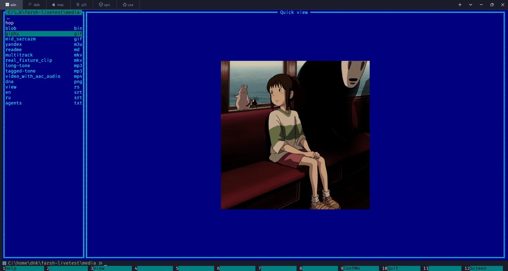
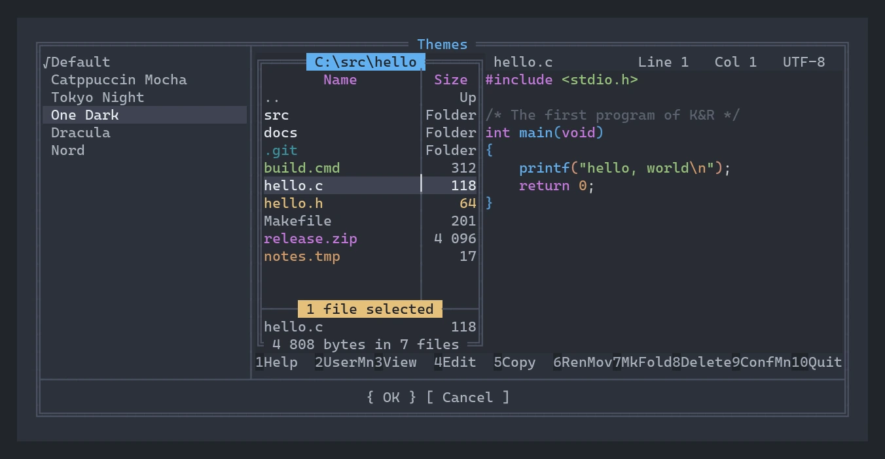
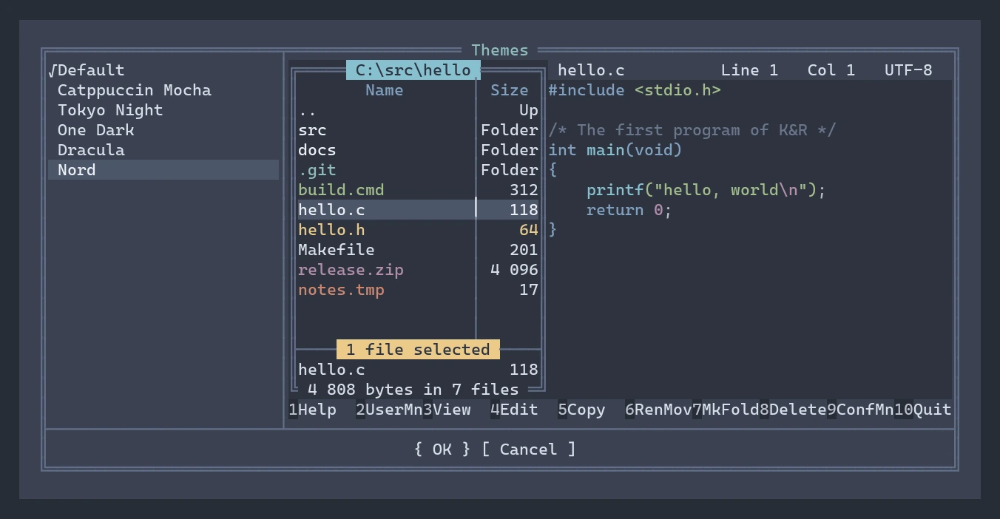

# farsh

**bash · zsh · PowerShell + Far Manager 3**

## Not Far with a shell built in. A shell with Far built in.

farsh starts your real bash, zsh or PowerShell and lays Far Manager's panels
over it — exactly as in Far 3, cell for cell. The command line under the panels
is the shell's own line, with your prompt, your aliases and your history. Press
`Ctrl+O` and you are looking at a clean shell, as if farsh were never there.

**[Install](#install)** · **[farsh.sarnet.ru](https://farsh.sarnet.ru)** (the site, in Russian)

## Upside down: for twenty-five years it was the other way round

Far has always had a command line. Its own: one edit box that hands your
command to `cmd.exe` and forgets about it at once. No completion of your
shell, no functions, no prompt, no PSReadLine, no fzf. A file manager with a
stump of a shell bolted on. farsh turns that construction upside down.

```
   how it was                          how it is in farsh

 ┌──────────────────────────┐        ┌──────────────────────────────────────┐
 │ Far Manager — the boss   │        │ Far's panels — a guest on top        │
 ├──────────────────────────┤   ⟶    ├──────────────────────────────────────┤
 │ its edit box → cmd.exe   │        │ your bash / zsh / PowerShell in a    │
 └──────────────────────────┘        │ PTY — the boss                       │
                                     └──────────────────────────────────────┘
```

**Far with a command line**

- the command line is an edit box of its own, not your shell;
- aliases, functions, profile, prompt — all missed;
- completion and history search — its own, cut down;
- command output lives in someone else's buffer;
- you cannot make it your login shell.

**farsh**

- under the panels is the line of your real shell: everything you type goes
  into its own line editor;
- your starship / oh-my-zsh / oh-my-posh, aliases, functions, history — all
  there;
- without the panels every key is the shell's again: Tab completion,
  `Ctrl+R`, your bindings;
- output goes to the terminal byte for byte: native scrollback, selection,
  mouse, links;
- you can make it your login shell — and it will not lock you out.

## One farsh — three systems

The same farsh in PowerShell on Windows, zsh on macOS and bash on Debian. Top
right — farsh's panels, htop under them, on the left — a plain shell with
fastfetch: farsh lives next to your programs, not instead of them.


**Windows 11** — PowerShell 7.6, the [Som](https://github.com/errordnk/som) terminal


**macOS** — zsh 5.9 on a Mac mini M4, the [Som](https://github.com/errordnk/som) terminal


**Debian 13** — bash 5.2, the [Som](https://github.com/errordnk/som) terminal

## What is inside: Far 3 as you remember it, and what it never had

farsh's panels, dialogs and menus are checked against the real Far 3.0.6446 by
a console dump — cell by cell, attribute by attribute, not by eye.

- **Panels as in Far 3.** Ten view modes, column widths, `Folder`/`Up`, sizes
  in K/M/G, sorting in Far's string order (digits as numbers), highlighting
  groups, a key bar that changes while you hold Shift/Ctrl/Alt.
- **Your shell, not a stump.** The command line is the shell's own line. Enter
  runs the command in the shell, the panels step aside for its output and come
  back with a fresh file list and the cursor where it was.
- **A login shell without risk.** `chsh -s farsh` — and everything that is not
  an interactive session (ssh commands, scp, rsync, scripts, `-c`, pipes)
  quietly goes to the real shell. If farsh ever crashes, the real shell picks
  the session up.
- **A real editor.** `F4` and `F3` are the built-in modern editor
  [fresh](https://github.com/errordnk/fresh): tree-sitter highlighting, mouse,
  selection, search — inside Far's status bar and key bar. `Ctrl+Q` shows the
  highlighted text of the file under the cursor.
- **Archives as folders.** arclite, ported: 7z, zip, tar and gzip open with
  Enter and are browsed like folders. Extracting, creating, adding to and
  deleting from a zip, testing an archive. Pure Rust, no 7-Zip needed.
- **Every file operation.** Copy, move, delete to the Recycle Bin and Wipe with
  Far's confirmations and progress, attributes and times (`Ctrl+A`), hard
  links, junctions and symlinks (`Alt+F6`), filters, find file, compare
  folders, descriptions.
- **Elevation.** "Access denied" on Windows — and you get Far's elevation
  dialog. A copy of farsh started through UAC does the job over a pipe only you
  can open.
- **Settings the Far way.** Every option under Far's name and with Far's
  default. `far:config` with all 297 settings, Far's help with links and
  search, a user menu in the `FarMenu.ini` format, associations, histories.
- **Russian — all of it.** The interface and the help in Russian from Far's own
  translation. Every shortcut works in the Russian layout too — like Xlat in
  Far.

## Media right in the terminal: F3 on a picture shows the picture. On an mp4 — the video

In the [Som](https://github.com/errordnk/som) terminal, farsh's viewer speaks its
rich-content protocol — and the terminal becomes a media centre without leaving
the file manager.


**`Ctrl+Q`** — the quick view: the cursor on `giphy.gif`, and the animation plays right in the panel, on the theme's background

- **Pictures and GIF.** PNG, JPEG, animated GIF — in `F3` over the whole screen
  or in the quick view panel while you move the cursor over the files.
- **Music and playlists.** mp3, flac, ogg with a player widget; `.m3u` and
  `.cue` playlists track by track, `n`/`p` to switch; internet radio.
- **Video.** mp4, mkv, avi right in the terminal. `a` — the next audio track,
  `s` — subtitles.
- **Markdown.** A `.md` document is drawn as a document — with headings, lists
  and embedded pictures, scrollable.
- **In the theme's colors.** The background of the widgets and of the margins
  around pictures follows farsh's theme.
- **In any other terminal.** farsh works everywhere: Windows Terminal, kitty,
  iTerm2, Alacritty. Text is shown as text, a binary file is honestly called
  binary.

## Themes: look before you choose

Options → Themes shows a live example of farsh in each theme: a panel with
files and the editor with code. Far's classic blue, Catppuccin Mocha, Tokyo
Night, One Dark, Dracula and Nord are built in; write your own in JSON and put
it into `~/.config/farsh/themes` ([format](docs/themes.md)). A theme colors
everything: panels, dialogs, menus, the editor's code highlighting and the
background of the media widgets. Below are real frames of that dialog.

| | |
|---|---|
|  Far's classic |  Catppuccin Mocha |
|  Tokyo Night |  One Dark |
|  Dracula |  Nord |

## Install

Five minutes — and you have Far in your own shell. Take the archive for your
system from the [latest release](https://github.com/errordnk/farsh/releases/latest): one binary, nothing else to install.

| System | Archive |
|---|---|
| Windows x64 | [farsh-windows-x64.zip](https://github.com/errordnk/farsh/releases/latest/download/farsh-windows-x64.zip) |
| macOS, Apple silicon | [farsh-macos-arm64.zip](https://github.com/errordnk/farsh/releases/latest/download/farsh-macos-arm64.zip) |
| Linux x86_64 | [farsh-linux-amd64.zip](https://github.com/errordnk/farsh/releases/latest/download/farsh-linux-amd64.zip) |
| Linux arm64 (Raspberry Pi 5 and others) | [farsh-linux-arm64.zip](https://github.com/errordnk/farsh/releases/latest/download/farsh-linux-arm64.zip) |

**Linux and macOS**

```sh
curl -LO https://github.com/errordnk/farsh/releases/latest/download/farsh-linux-amd64.zip   # or -linux-arm64, -macos-arm64
unzip -o farsh-linux-amd64.zip -d ~/.local/bin
~/.local/bin/farsh
```

The Linux binaries need glibc 2.41 or newer (Debian 13, Ubuntu 25.04 and
later). On macOS a binary downloaded with a browser is quarantined: clear it
with `xattr -d com.apple.quarantine ~/.local/bin/farsh`.

Make it your login shell, if you like:

```sh
echo ~/.local/bin/farsh | sudo tee -a /etc/shells
chsh -s ~/.local/bin/farsh
```

Your old shell still does the work: farsh takes `$FARSH_SHELL`, or
`Shell.Program` from its settings, or `$SHELL` if that is not farsh, else bash
(zsh on macOS).

**Windows**

Unpack `farsh.exe` into a folder on your `PATH` and run it in Windows Terminal
or [Som](https://github.com/errordnk/som). The default shell is PowerShell; Git Bash and MSYS2's bash work too.
FFmpeg (for a video's audio tracks and subtitles) is packed inside and loaded
only when needed.

**From source**

With Rust 1.88 or newer ([rustup.rs](https://rustup.rs)) and a C compiler:

```sh
cargo install --locked --git https://github.com/errordnk/farsh --root ~/.local
```

On Windows the build links FFmpeg from [vcpkg](https://vcpkg.io): install
`ffmpeg:x64-windows` and point `VCPKG_ROOT` at it.

## First steps: your hands remember everything

If you have worked in Far, you can already work in farsh. Here is what is worth
knowing on top of that.

| Key | What it does |
|---|---|
| `Ctrl+O` | panels on / off — without them you are in a clean shell |
| any text | goes to the shell's command line, `Enter` runs it |
| `Tab` | the other panel (without the panels Tab is your shell's completion) |
| `Ctrl+E` `Ctrl+X` | shell history back / forward (the arrows move the panel cursor) |
| `F3` `F4` `Ctrl+Q` | view, edit, quick view in the other panel |
| `F5` `F6` `F7` `F8` | copy, move, make folder, delete |
| `Alt+F7` | find file |
| `F9` | the menu: Left, Files, Commands, Options (Themes is there), Right |
| `Ctrl+1`…`Ctrl+0` | Far's ten view modes |
| `Ctrl+F3`…`Ctrl+F12` | sorting |
| `F1` | Far's help, with links |
| `far:config` + `Enter` | every setting |
| `F10` | quit |

## License

farsh is free software under GPL-3.0-or-later (see `LICENSE`), so that
[fresh](https://github.com/errordnk/fresh) (GPL-3.0) can be built in as its
editor and viewer. Far's help files in `assets/help` are under Far Manager's
BSD license (beside them). Versions released before the move to GPL were MIT.
Known, deliberate differences from Far are written down in
[AGENTS.md](AGENTS.md).
